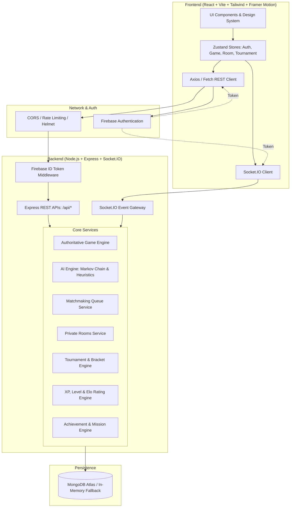

# Triad Arena — System Architecture Document

## 1. System Overview
**Triad Arena** is a real-time, competitive, skill-and-prediction web game based on an advanced Rock-Paper-Scissors ruleset. The platform provides:
- **Solo Play**: Three AI tiers (Easy: Random; Medium: Frequency Counter; Hard: Markov Chain prediction).
- **Multiplayer 1v1**: Queue-based matchmaking (Elo-widening window) and Private Custom Rooms with 6-character codes.
- **Commit-Reveal Mechanism**: Strict cryptographic/server-authoritative move locking preventing any client-side move snooping.
- **Single-Elimination Tournaments**: Automated bracket seeding, auto-advancement, and virtual point rewards.
- **Progression & Gamification**: Mathematical XP & Level curve, Elo rating, 15+ achievements, daily missions (00:00 UTC reset), and seasonal resets.

---

## 2. High-Level Architectural Diagram


---

## 3. Directory Layout
```
d:/TriadArena/
├── client/
│   ├── public/
│   ├── src/
│   │   ├── assets/
│   │   ├── components/         # Button, Card, Modal, Toast, Input, Tabs, Badge, Avatar, ProgressBar, etc.
│   │   ├── features/           # Feature-specific modules (solo, multiplayer, rooms, tournament, etc.)
│   │   ├── hooks/              # Custom React hooks (useSocket, useAuth, useCountdown, etc.)
│   │   ├── lib/                # API client, Firebase client, Sound effects, Utils
│   │   ├── pages/              # Landing, HowToPlay, Dashboard, Play, Solo, Lobby, Room, Tournaments, etc.
│   │   ├── store/              # Zustand state stores
│   │   ├── styles/             # Tailwind design tokens, glow animations, theme variables
│   │   ├── App.tsx
│   │   └── main.tsx
│   ├── index.html
│   ├── package.json
│   ├── tailwind.config.js
│   └── vite.config.ts
├── server/
│   ├── src/
│   │   ├── config/             # Config, environment, db connection, game constants
│   │   ├── controllers/        # REST controllers
│   │   ├── middleware/         # Auth, validation, rate limiting, error handling
│   │   ├── models/             # Mongoose data schemas (User, Match, Room, Tournament, etc.)
│   │   ├── routes/             # Express API routes
│   │   ├── services/           # GameEngine, AiEngine, Matchmaking, Tournament, Progression
│   │   ├── sockets/            # Socket.IO handlers, commit-reveal state machine, disconnect recovery
│   │   ├── utils/              # Logger, response formatters, seed data
│   │   ├── validators/         # Zod schemas for input validation
│   │   └── server.ts           # Main Express + HTTP + Socket.IO server
│   ├── tests/                  # Vitest/Jest unit and integration tests
│   ├── package.json
│   └── tsconfig.json
├── shared/
│   ├── constants/              # Move types, outcomes, game modes, timers
│   ├── types/                  # Shared TypeScript interfaces & types
│   └── game-rules/             # Pure rule evaluation functions, Elo formulas, XP curves
├── docs/
│   ├── architecture.md
│   ├── api.md
│   ├── socket-events.md
│   └── game-rules.md
├── .github/workflows/
│   └── ci.yml
├── .env.example
└── README.md
```

---

## 4. Key Security & Resilience Decisions

### A. Authoritative Server & Zero Move Snooping
Under no circumstances is an opponent's choice transmitted to the opposing client during the commit phase.
1. When Player A locks "Rock", the server stores `moves[playerA] = "rock"` in server memory/DB.
2. The server broadcasts:
   ```json
   { "event": "match:player_committed", "playerId": "user_a", "round": 1 }
   ```
3. Only when both players have locked moves (or the 10-second turn timer expires) does the server evaluate the round and emit:
   ```json
   {
     "event": "match:round_reveal",
     "round": 1,
     "moves": { "user_a": "rock", "user_b": "scissors" },
     "winnerId": "user_a",
     "outcome": "win",
     "scores": { "user_a": 1, "user_b": 0 }
   }
   ```

### B. Idempotency & XP Protection
Match completion generates an `idempotencyKey` formatted as `match_end:<matchId>`. The database record is updated using atomic conditional operations (`{ status: { $ne: 'completed' } }`). Repeated requests or client reconnects cannot trigger duplicate Elo or XP gains.

### C. Graceful Disconnect & Recovery
- When a client socket drops mid-match, the server initiates a **45-second reconnection grace timer**.
- The opponent is alerted with `match:player_disconnected { gracePeriodMs: 45000 }`.
- If the player reconnects with valid session tokens within 45 seconds, the server resumes the match and provides a complete synchronized state snapshot (`match:state_restore`).
- If the timer elapses without reconnection, the remaining player is awarded a forfeit victory.

### D. Hosting Strategy
- **Frontend**: Static/SPA deployment on Vercel.
- **Backend**: Long-lived Node.js process on Railway / Render / Fly.io with native WebSocket support.
- Note: Serverless environments (like standard Vercel serverless functions) terminate persistent WebSocket connections; therefore, Socket.IO must reside on dedicated persistent compute.
