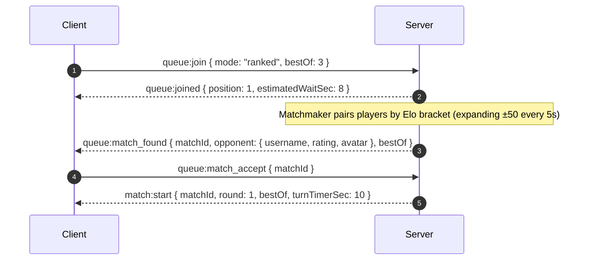

# Triad Arena — Socket.IO Real-Time Protocol Specification

## 1. Connection & Authentication
- **Endpoint**: `/socket.io/`
- **Auth Handshake**:
  ```javascript
  const socket = io(SERVER_URL, {
    auth: {
      token: "<firebase_id_token>"
    },
    transports: ["websocket", "polling"]
  });
  ```
- **Connection Validation**: Server extracts `token`, verifies via Firebase Admin SDK (or mock dev auth provider in dev mode), and attaches `socket.data.user = { userId, username, rating }`.

---

## 2. Matchmaking Queue Lifecycle



### Events:
- `queue:join`: `{ bestOf?: number }`
- `queue:leave`: `{}`
- `queue:status`: Broadcasts current wait time & pool size.
- `queue:match_found`: `{ matchId, opponent, bestOf }`

---

## 3. Commit-Reveal Match Protocol

```mermaid
sequenceDiagram
    autonumber
    rect rgb(20, 25, 50)
    Note over Client A, Client B: Round 1 Begins (10s Countdown)
    Client A->>Server: match:commit_move { matchId, round: 1, move: "rock" }
    Server-->>Client A: match:commit_ack { round: 1 }
    Server-->>Client B: match:player_committed { playerId: "playerA", round: 1 }
    Note over Client B: Opponent UI displays "Player A Locked In" (NO MOVE REVEALED)
    Client B->>Server: match:commit_move { matchId, round: 1, move: "scissors" }
    Server-->>Client B: match:commit_ack { round: 1 }
    Server-->>Client A: match:player_committed { playerId: "playerB", round: 1 }
    end

    rect rgb(30, 40, 70)
    Note over Server: Both locked! Evaluate outcome: Rock beats Scissors
    Server-->>Client A: match:round_reveal { round: 1, moves: { playerA: "rock", playerB: "scissors" }, winnerId: "playerA", scores: { playerA: 1, playerB: 0 }, isMatchOver: false }
    Server-->>Client B: match:round_reveal { round: 1, moves: { playerA: "rock", playerB: "scissors" }, winnerId: "playerA", scores: { playerA: 1, playerB: 0 }, isMatchOver: false }
    end
```



### Move Commitment:
- `match:commit_move`: `{ matchId: string, roundNumber: number, move: "rock" | "paper" | "scissors" }`
- `match:commit_ack`: `{ roundNumber: number }`
- `match:player_committed`: `{ playerId: string, roundNumber: number }` (Signals commitment without choice)

### Round Reveal:
- `match:round_reveal`:
  ```json
  {
    "roundNumber": 1,
    "moves": {
      "user_1": "rock",
      "user_2": "scissors"
    },
    "roundWinnerId": "user_1",
    "outcome": "win",
    "scores": {
      "user_1": 1,
      "user_2": 0
    },
    "isMatchOver": false,
    "nextRoundInSec": 3
  }
  ```

### Match Over:
- `match:game_over`:
  ```json
  {
    "matchId": "...",
    "winnerId": "user_1",
    "finalScores": { "user_1": 2, "user_2": 1 },
    "ratingChanges": {
      "user_1": { "before": 1200, "after": 1224, "delta": 24 },
      "user_2": { "before": 1210, "after": 1186, "delta": -24 }
    },
    "xpEarned": { "user_1": 120, "user_2": 45 },
    "unlockedAchievements": ["first_win"]
  }
  ```

---

## 4. Reconnection & Resilience

- **On Disconnect**:
  - Server holds match state in memory for **45 seconds**.
  - Emits to opponent: `match:player_disconnected { playerId, gracePeriodMs: 45000 }`.
- **On Reconnect**:
  - Reconnecting client sends: `match:reconnect { matchId }`.
  - Server verifies match membership and emits `match:state_restore` with entire round history, current scores, time left, and committed status.
  - Server emits `match:player_reconnected { playerId }` to opponent.
- **Grace Period Expiry**:
  - Server awards forfeit win to the connected player and emits `match:forfeit_win { winnerId, reason: "opponent_timeout" }`.
